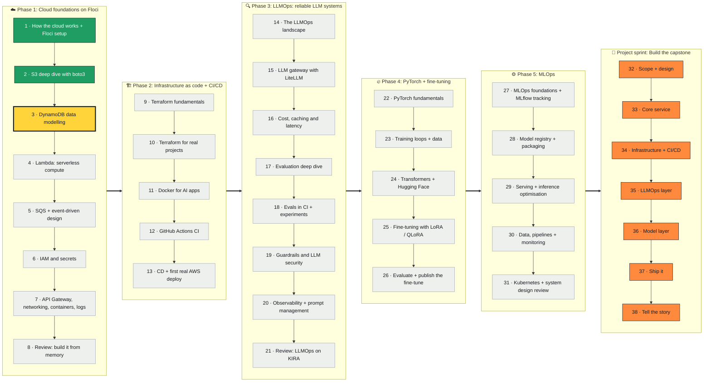
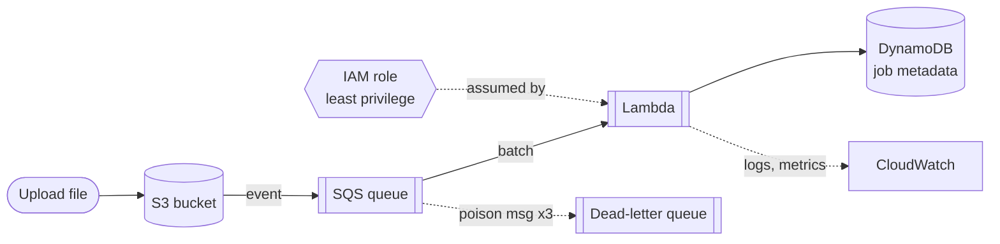

# 🗺️ AI Cloud Ops Roadmap

[Live roadmap](https://ai-cloud-ops-roadmap.vercel.app/) · [Offline copy](<Vaibhav's AI Engineer Roadmap.html>) · 38 days, 2-3 h/day

```
Progress  █░░░░░░░░░░░░░░░░░░░  2 / 38 days  (5%)
```

**Status key:** ✅ done · 🔜 up next · ⬜ todo · 🧪 review day · 🚀 project day. Expand a day for its submodules (e.g. 3.1, 3.2).

## Overview

| Phase | Days | Done |
|---|---|---|
| ☁️ Phase 1: Cloud foundations on Floci | 1–8 | 2 / 8 |
| 🏗️ Phase 2: Infrastructure as code + CI/CD | 9–13 | 0 / 5 |
| 🔍 Phase 3: LLMOps: reliable LLM systems | 14–21 | 0 / 8 |
| 🔥 Phase 4: PyTorch + fine-tuning | 22–26 | 0 / 5 |
| ⚙️ Phase 5: MLOps | 27–31 | 0 / 5 |
| 🚀 Project sprint: Build the capstone | 32–38 | 0 / 7 |

## Path



🟩 done · 🟨 up next · ⬜ todo · 🟧 capstone

## Day 8 target: event-driven pipeline

You build this from memory in Phase 1 (Days 3-6 supply each piece).



---

## ☁️ Phase 1 · Days 1–8: Cloud foundations on Floci

> **Goal:** Learn the AWS services an AI backend actually uses. You'll practise through code on a local emulator, so there's no bill and nothing you can break.
>
> **Outcome:** You can explain and use S3, DynamoDB, Lambda, SQS, IAM, API Gateway and CloudWatch, and you have built a small event-driven pipeline from memory.

<details>
<summary>✅ <b>Day 1</b>: How the cloud works + Floci setup</summary>

**1.1 Cloud mental model**

Regions, availability zones, edge locations and the shared responsibility model. These words come up in every cloud interview.

- [x] Watch the first modules of Cloud Practitioner Essentials
- [x] Write a 5-line summary in your own words

**1.2 The AWS service map**

Group services by job: compute (Lambda, ECS, EC2), storage (S3), databases (DynamoDB, RDS), messaging (SQS, SNS, EventBridge), identity (IAM).

- [x] Draw the map on paper, with one example use for each service in an AI app

**1.3 Install Floci + AWS CLI**

Floci gives you a local AWS on port 4566. Any AWS CLI or SDK call can point at it.

- [x] Install Docker, the AWS CLI and the Floci CLI
- [x] Run `floci start`, then `eval $(floci env)`
- [x] Run `floci doctor` if something fails

**1.4 First bucket + floci-ui**

Prove the loop works end to end.

- [x] `aws s3 mb s3://scratch`, then upload any file
- [x] Open floci-ui and find the bucket and the object

</details>

<details>
<summary>✅ <b>Day 2</b>: S3 deep dive with boto3</summary>

**2.1 boto3 sessions, clients, endpoints**

A client is a thin API wrapper, and the endpoint decides where calls go. Setting `AWS_ENDPOINT_URL` switches between Floci and real AWS without changing code.

- [x] Create a `get_s3()` helper that reads the endpoint from env

**2.2 Upload, download, list**

The everyday S3 operations, plus multipart upload for large files.

- [x] Write `upload_file`, `download_file` and `list_prefix` helpers
- [x] Upload 20 files under `reports/2026/` and list by prefix

**2.3 Presigned URLs**

Short-lived links that let a browser download or upload without your AWS credentials.

- [x] Generate a 5-minute download link and open it with curl

**2.4 Versioning, lifecycle, storage classes**

How teams keep old versions and cut storage cost automatically.

- [x] Read the S3 lifecycle page and write a rule that would move old reports to cheaper storage

</details>

<details>
<summary>🔜 <b>Day 3</b>: DynamoDB data modelling</summary>

**3.1 Keys and access patterns**

In DynamoDB you design the table around your queries. List the queries first, then choose the partition and sort keys.

- [ ] List 3 access patterns for a research-jobs table
- [ ] Pick PK = `user_id` and SK = `created_at#job_id`, and justify the choice

**3.2 CRUD, Query vs Scan**

Put, get, update and delete. Query reads one partition; Scan reads the whole table.

- [ ] Insert 50 items, then query one user's jobs within a date range

**3.3 Global secondary indexes**

Add a second access pattern without duplicating data by hand.

- [ ] Add a GSI on `status` and query all pending jobs

**3.4 Conditional writes**

Only write if a condition holds. This is the basis for idempotent workers later.

- [ ] Write a status update that only succeeds if status is still `pending`

</details>

<details>
<summary>⬜ <b>Day 4</b>: Lambda: serverless compute</summary>

**4.1 Execution model**

Handlers, events, cold vs warm starts, the 15-minute limit and how memory affects CPU.

- [ ] Read the Lambda concepts page and note the limits

**4.2 Zip deploy to Floci**

Package a handler and invoke it from the CLI.

- [ ] Write `handler(event, context)` and deploy it with the AWS CLI
- [ ] Invoke it and read the response

**4.3 Config: env vars, timeouts, memory**

The settings that decide cost and reliability.

- [ ] Add an env var, set the timeout to 30 s and trigger a timeout on purpose

**4.4 Container images**

Package Python with heavy dependencies (LangGraph, etc.) as a Docker image instead of a zip.

- [ ] Build a Lambda container image from the AWS base image and deploy it to Floci

</details>

<details>
<summary>⬜ <b>Day 5</b>: SQS + event-driven design</summary>

**5.1 Queues and delivery semantics**

Standard vs FIFO queues, at-least-once delivery, visibility timeout, long polling.

- [ ] Send and receive messages from the CLI
- [ ] Let one sit past its visibility timeout and watch it reappear

**5.2 SQS → Lambda trigger**

Lambda polls the queue for you and passes messages in batches.

- [ ] Connect the queue to yesterday's Lambda with a batch size of 5

**5.3 Dead-letter queues + redrive**

Messages that keep failing move aside so they can't block the queue.

- [ ] Make the Lambda fail on a 'poison' message
- [ ] Configure a DLQ with maxReceiveCount = 3 and redrive after a fix

**5.4 Fan-out: SNS and EventBridge**

One event, many consumers. Know when each tool fits.

- [ ] Read the EventBridge overview; write 3 lines comparing SQS, SNS and EventBridge

</details>

<details>
<summary>⬜ <b>Day 6</b>: IAM and secrets</summary>

**6.1 Policy anatomy**

Effect, Action, Resource, Condition. Learn how to read any policy.

- [ ] Read three AWS managed policies and explain each in one sentence

**6.2 Roles and trust policies**

A role is an identity that a service assumes. The trust policy says who can assume it.

- [ ] Write an execution role for your Lambda with a trust policy for lambda.amazonaws.com

**6.3 Least privilege on Floci**

Turn on enforcement and fix what breaks.

- [ ] Restart Floci with `FLOCI_SERVICES_IAM_ENFORCEMENT_ENABLED=true`
- [ ] Grant only the exact SQS, S3 and DynamoDB actions the function needs

**6.4 Secrets Manager vs Parameter Store**

Where API keys belong, how rotation works, and how to cache secrets in Lambda.

- [ ] Store your Groq key, read it at cold start and cache it

</details>

<details>
<summary>⬜ <b>Day 7</b>: API Gateway, networking, containers, logs</summary>

**7.1 VPC basics**

Subnets (public vs private), route tables, NAT and security groups, at the concept level.

- [ ] Read the VPC overview and draw a two-subnet diagram

**7.2 API Gateway**

HTTP vs REST APIs, routes, integrations with Lambda.

- [ ] Put an HTTP API in front of your Lambda on Floci and curl it

**7.3 ECR + ECS Fargate vs Lambda**

Containers that run long, or always on, versus functions that run on demand.

- [ ] Write a decision table: duration, cost, cold start, GPU, scaling

**7.4 CloudWatch logs, metrics, alarms**

Where your print statements go, and how to alert on errors.

- [ ] Find your Lambda's logs; read the Errors and Duration metrics
- [ ] Write an alarm definition for error rate

</details>

<details>
<summary>🧪 <b>Day 8</b>: Review: build it from memory</summary>

**8.1 Mini pipeline**

Upload to S3 → event → SQS → Lambda → metadata in DynamoDB.

- [ ] Build it with boto3 and the CLI only, no copy-paste

**8.2 One-page cheat sheet**

Each service: what it is, when to use it, one gotcha.

- [ ] Write it in your notes repo

**8.3 Self-quiz**

Answer the interview questions from Days 1–7 out loud.

- [ ] Record yourself answering 5 questions and listen back

</details>


## 🏗️ Phase 2 · Days 9–13: Infrastructure as code + CI/CD

> **Goal:** Everything as code: Terraform for infrastructure, Docker for apps, GitHub Actions for tests and deploys, and one safe trip to real AWS.
>
> **Outcome:** Resume-ready: Terraform, Docker Compose, GitHub Actions with OIDC deploys to AWS, and CI that tests AWS code against a local emulator.

<details>
<summary>⬜ <b>Day 9</b>: Terraform fundamentals</summary>

**9.1 HCL, providers, resources**

The language and the building blocks.

- [ ] Do the first HashiCorp AWS tutorial

**9.2 The core workflow and state**

init → plan → apply → destroy. State is how Terraform knows what exists.

- [ ] Inspect `terraform.tfstate` after an apply and find your bucket

**9.3 Point the provider at Floci**

Set custom endpoints and test credentials so the same code can target real AWS later.

- [ ] Configure the provider endpoints for s3, sqs, dynamodb, lambda and iam

**9.4 Data sources and outputs**

Read existing things and expose values to other tools.

- [ ] Output the queue URL and table ARN

</details>

<details>
<summary>⬜ <b>Day 10</b>: Terraform for real projects</summary>

**10.1 Variables, tfvars, locals**

Parameterise names, environments and sizes.

- [ ] Add `env` and `project` variables and a `dev.tfvars`

**10.2 Modules**

Reusable building blocks, like functions for infrastructure.

- [ ] Create a `queue_worker` module: SQS + DLQ + Lambda + role

**10.3 Remote state + locking**

Shared state in S3 so a team, or CI, can't corrupt it.

- [ ] Configure an S3 backend against Floci

**10.4 Rebuild the Day 8 pipeline**

Your first full stack as code.

- [ ] Destroy and re-apply twice to prove it's repeatable

</details>

<details>
<summary>⬜ <b>Day 11</b>: Docker for AI apps</summary>

**11.1 Multi-stage builds with uv**

Build dependencies in one stage, ship a slim runtime.

- [ ] Write a multi-stage Dockerfile for a FastAPI app with uv

**11.2 Layer caching and image size**

Copy the lockfile before the source; use .dockerignore.

- [ ] Compare image sizes before and after the changes

**11.3 Compose the local stack**

App + Floci + Redis + Postgres on one network.

- [ ] Write `compose.yaml` with all four services

**11.4 Health checks and config**

Containers that report readiness, and config through env vars.

- [ ] Add a `/health` endpoint and Compose health checks

</details>

<details>
<summary>⬜ <b>Day 12</b>: GitHub Actions CI</summary>

**12.1 Workflows, jobs, caching**

Triggers, matrices and dependency caching.

- [ ] Create `ci.yml` that runs on pull requests

**12.2 Lint + tests**

ruff and pytest as required checks.

- [ ] Add both and make one fail on purpose

**12.3 Floci as a service container**

A real local AWS inside CI.

- [ ] Run Floci as a service and point the tests at it

**12.4 Build the image**

Make sure the Dockerfile builds on every PR.

- [ ] Add a docker build step with layer caching

</details>

<details>
<summary>⬜ <b>Day 13</b>: CD + first real AWS deploy</summary>

**13.1 Account hygiene**

MFA on root, an admin IAM identity, a budget alarm before anything else.

- [ ] Check AWS's current free-tier / credit terms
- [ ] Create a Budget alarm at about $5

**13.2 OIDC from GitHub to AWS**

Short-lived credentials, with no long-lived keys anywhere.

- [ ] Create the OIDC provider and a deploy role limited to your repo

**13.3 Plan on PR, apply on main**

The standard Terraform delivery flow.

- [ ] Post `terraform plan` output on PRs; apply after merge

**13.4 Deploy, verify, destroy**

Prove it works on real AWS, then stop paying.

- [ ] Run the pipeline on real AWS, check CloudWatch logs, run `terraform destroy`

</details>


## 🔍 Phase 3 · Days 14–21: LLMOps: reliable LLM systems

> **Goal:** The production layer around LLM apps: gateways, cost, evals, CI gates, guardrails and observability. You already have a head start from Tracky.
>
> **Outcome:** You can design and explain an LLM app's ops layer end to end, and you have built each piece once.

<details>
<summary>⬜ <b>Day 14</b>: The LLMOps landscape</summary>

**14.1 MLOps vs LLMOps**

Training pipelines vs prompts, retrieval, evals and API cost.

- [ ] Watch an FSDL LLM Bootcamp lecture on deployment and ops

**14.2 The LLM app lifecycle**

Prompt → evaluate → deploy → monitor → improve.

- [ ] Read the evaluation and deployment chapters of AI Engineering

**14.3 Map your Tracky work**

You already do routing evals, judges, tracing and PII hashing.

- [ ] Mark each Tracky piece on the lifecycle diagram and note the gaps

</details>

<details>
<summary>⬜ <b>Day 15</b>: LLM gateway with LiteLLM</summary>

**15.1 Unified API: SDK vs proxy**

One OpenAI-style interface for Groq, Gemini, OpenAI and Ollama.

- [ ] Replace direct client calls in one project with LiteLLM

**15.2 Fallbacks, retries, timeouts**

Resilience when a provider is slow or down.

- [ ] Configure Groq → Gemini fallback with backoff
- [ ] Break the Groq key and confirm the fallback

**15.3 Rate limits and budgets**

Per-key spend caps and request limits.

- [ ] Run the LiteLLM proxy with a virtual key and a small budget

**15.4 Load balancing**

Spread traffic across deployments or providers.

- [ ] Configure two deployments of the same model and watch the routing

</details>

<details>
<summary>⬜ <b>Day 16</b>: Cost, caching and latency</summary>

**16.1 Token economics**

Input vs output tokens, context length and cost per request.

- [ ] Log tokens and cost for 50 requests and compute the average

**16.2 Exact vs semantic cache**

A Redis key cache vs embedding-similarity cache, and when each is safe.

- [ ] Enable a Redis cache; measure the hit rate and latency

**16.3 Streaming and latency metrics**

TTFT, total latency, p50 vs p95.

- [ ] Stream responses and measure TTFT vs total time

**16.4 Concurrency and batching**

asyncio.gather, semaphores and provider rate limits.

- [ ] Run 30 requests concurrently with a semaphore of 5

</details>

<details>
<summary>⬜ <b>Day 17</b>: Evaluation deep dive</summary>

**17.1 Golden datasets and slices**

Representative cases, edge cases and per-slice scores.

- [ ] Write 30 cases tagged by category

**17.2 Deterministic scorers**

Schema validity, citations present, regex and length checks. They're cheap and reliable.

- [ ] Write 4 code-based scorers

**17.3 Judge design and calibration**

Rubrics, pairwise vs absolute scoring, and agreement with human labels.

- [ ] Hand-label 20 outputs and measure judge agreement

**17.4 RAG metrics**

Faithfulness, answer relevance, context precision and recall.

- [ ] Run Ragas-style metrics on KIRA

</details>

<details>
<summary>⬜ <b>Day 18</b>: Evals in CI + experiments</summary>

**18.1 Regression thresholds**

Compare against a stored baseline; fail if a score drops.

- [ ] Store the baseline JSON and write a compare script

**18.2 Eval job in GitHub Actions**

Run only when prompt or graph files change.

- [ ] Add a path-filtered eval job that fails the PR

**18.3 Keeping CI cheap**

Small smoke set on PRs, full set nightly, cached responses.

- [ ] Split into a smoke set (10) and a full set (30)

**18.4 Online evals and A/B tests**

Score a sample of production traces; compare prompt versions.

- [ ] Run a judge over 20 logged traces and compare two prompt variants

</details>

<details>
<summary>⬜ <b>Day 19</b>: Guardrails and LLM security</summary>

**19.1 OWASP Top 10 for LLMs**

The standard list of LLM app risks.

- [ ] Read it and pick the 4 that apply to your projects

**19.2 Prompt injection defences**

Direct vs indirect injection, separating instructions from data, least-privilege tools.

- [ ] Add an injection check on retrieved content
- [ ] Write 3 adversarial eval cases

**19.3 Structured output validation**

Pydantic schemas, retries on failure, constrained decoding.

- [ ] Validate final outputs and retry once with the error message

**19.4 PII protection**

Redaction, hashing and keeping identifiers out of prompts and traces. You already built this at Tracky.

- [ ] Write up your HMAC approach as a short design note for interviews

</details>

<details>
<summary>⬜ <b>Day 20</b>: Observability + prompt management</summary>

**20.1 Tracing for agents**

Spans per node and tool call; traces, metrics and logs.

- [ ] Read the OpenTelemetry primer; check your traces show every graph node

**20.2 Dashboards and alerts**

p95 latency, error rate, cost per request, token usage.

- [ ] Build the dashboard and write 3 alert rules with thresholds

**20.3 Prompt versioning**

A prompt registry or versioned files, labels and rollback.

- [ ] Move prompts into Langfuse prompt management or versioned files

**20.4 Feedback loops**

Thumbs up/down, user corrections, turning failures into eval cases.

- [ ] Add a feedback endpoint that logs a score against the trace

</details>

<details>
<summary>🧪 <b>Day 21</b>: Review: LLMOps on KIRA</summary>

**21.1 Speed-run on KIRA**

Gateway + 10-case eval + output validation in one session.

- [ ] Timebox each piece to 40 minutes

**21.2 LLMOps cheat sheet**

One page: the layers, the tools, the metrics.

- [ ] Write it in your notes repo

**21.3 Mock questions**

Answer the Days 14–20 questions out loud.

- [ ] Record and review

</details>


## 🔥 Phase 4 · Days 22–26: PyTorch + fine-tuning

> **Goal:** Understand training from the ground up, then fine-tune a small LLM with LoRA and prove it helped.
>
> **Outcome:** Resume-ready: LoRA fine-tuned a ~1B model for structured extraction (valid JSON X% → Y%) and published it on the Hugging Face Hub.

<details>
<summary>⬜ <b>Day 22</b>: PyTorch fundamentals</summary>

**22.1 Tensors, shapes, devices**

Creation, broadcasting, reshaping, moving to GPU.

- [ ] Do the PyTorch tensors tutorial; fix 3 shape errors on purpose

**22.2 Autograd**

How gradients are tracked and computed.

- [ ] Compute gradients of a small function by hand, then check them with autograd

**22.3 nn.Module, losses, optimizers**

Models as modules; cross-entropy; SGD vs AdamW.

- [ ] Build a 2-layer MLP and pick a loss and optimizer

</details>

<details>
<summary>⬜ <b>Day 23</b>: Training loops + data</summary>

**23.1 Dataset and DataLoader**

Batching, shuffling, collate functions.

- [ ] Write a custom Dataset for a small CSV

**23.2 Train/validate loop by hand**

zero_grad → forward → loss → backward → step, with no Trainer.

- [ ] Write the loop and plot train vs val loss

**23.3 Overfitting and schedules**

Regularisation, early stopping, learning-rate schedules.

- [ ] Add early stopping and a cosine LR schedule

**23.4 GPU + mixed precision**

Colab GPUs, autocast, memory basics.

- [ ] Run on a Colab T4 with AMP and compare speed

</details>

<details>
<summary>⬜ <b>Day 24</b>: Transformers + Hugging Face</summary>

**24.1 Tokenizers and attention intuition**

Tokens, embeddings, self-attention at a whiteboard level.

- [ ] Read The Illustrated Transformer; tokenize 3 sentences

**24.2 Loading models and generating**

`AutoModelForCausalLM`, generation parameters.

- [ ] Run a small instruct model and vary temperature and top-p

**24.3 Chat templates**

Why fine-tuning data must match the model's chat format.

- [ ] Apply the chat template to a conversation and print the raw text

**24.4 Memory maths**

Parameters × bytes per parameter, plus activations and the KV cache.

- [ ] Estimate memory for 0.5B, 1.5B and 7B in fp16 and 4-bit

</details>

<details>
<summary>⬜ <b>Day 25</b>: Fine-tuning with LoRA / QLoRA</summary>

**25.1 Fine-tune vs RAG vs prompting**

Fine-tuning changes behaviour and format. RAG adds knowledge. Prompting comes first.

- [ ] Write a decision table you could use in interviews

**25.2 SFT data and synthetic data**

Instruction format, quality over quantity, train/test split. Use public or synthetic data only.

- [ ] Generate 300–1000 text → JSON examples and hold out 15%

**25.3 LoRA and QLoRA**

Low-rank adapters; rank, alpha, target modules; 4-bit base weights.

- [ ] Read the PEFT LoRA guide and choose your settings

**25.4 Train on Colab**

Use TRL's SFTTrainer or Unsloth on a free GPU.

- [ ] Fine-tune a ~0.5–1.5B instruct model and save the adapter

</details>

<details>
<summary>⬜ <b>Day 26</b>: Evaluate + publish the fine-tune</summary>

**26.1 Base vs fine-tuned evaluation**

Held-out set; valid-JSON rate, field accuracy, judge spot checks.

- [ ] Run both models on the test set and record the scores

**26.2 Overfitting and forgetting checks**

Make sure general ability didn't collapse.

- [ ] Run 10 general prompts on both models and compare

**26.3 Merge and publish**

Merge the adapter, write a model card, push to the Hub.

- [ ] Push the adapter and card with results and limits

**26.4 Preference tuning (concept)**

What DPO and RLHF add after SFT.

- [ ] Read the TRL DPO overview; write 5 lines

</details>


## ⚙️ Phase 5 · Days 27–31: MLOps

> **Goal:** Track, version, serve and monitor models. Know the wider MLOps tooling well enough to discuss it confidently.
>
> **Outcome:** Resume-ready: MLflow tracking and registry, quantized serving with benchmarks, and working knowledge of DVC, Prefect, Evidently and Kubernetes.

<details>
<summary>⬜ <b>Day 27</b>: MLOps foundations + MLflow tracking</summary>

**27.1 ML lifecycle and maturity**

From manual notebooks to automated CI/CD/CT.

- [ ] Read Google's MLOps levels article; place Tracky on it

**27.2 MLflow tracking**

Params, metrics, artifacts, autologging.

- [ ] Run a local MLflow server and log a run

**27.3 Compare fine-tune runs**

Re-run with 2 LoRA ranks and compare in the UI.

- [ ] Pick the best run and write down why

**27.4 W&B side by side**

Same run logged to W&B, so you can compare the tools honestly.

- [ ] Add `report_to='wandb'` to one run

</details>

<details>
<summary>⬜ <b>Day 28</b>: Model registry + packaging</summary>

**28.1 Registry, versions, aliases**

Register, version, set `champion` and `challenger` aliases.

- [ ] Register two versions; point champion at the better one

**28.2 Signatures and pyfunc**

A standard interface so any service can load the model.

- [ ] Log the model with an input/output signature

**28.3 Promotion in CI**

Promote only if evals beat the current champion.

- [ ] Write a script that compares metrics and moves the alias

</details>

<details>
<summary>⬜ <b>Day 29</b>: Serving + inference optimisation</summary>

**29.1 Serving patterns**

Batch vs online vs streaming; sync vs async APIs.

- [ ] Write when you would use each, with one example

**29.2 Quantization**

fp16 → int8/int4, GGUF, quality trade-offs.

- [ ] Quantize your merged model to GGUF

**29.3 Ollama vs vLLM**

Local single-user vs high-throughput serving with continuous batching.

- [ ] Serve with Ollama behind FastAPI; read the vLLM architecture overview

**29.4 Benchmark**

Latency (p50/p95) and requests per second.

- [ ] Load test with Locust and record a table

</details>

<details>
<summary>⬜ <b>Day 30</b>: Data, pipelines + monitoring</summary>

**30.1 DVC data versioning**

Track datasets like Git tracks code.

- [ ] Track your SFT dataset with DVC, change it and switch versions

**30.2 Orchestration with Prefect**

Turn a script into a scheduled, retryable flow.

- [ ] Wrap generate → train → evaluate as a Prefect flow

**30.3 Drift with Evidently**

Compare reference vs current data distributions.

- [ ] Generate a drift report on two dataset versions

**30.4 Feature stores (concept)**

Keeping training and serving features consistent.

- [ ] Read the Feast overview; write 5 lines

</details>

<details>
<summary>🧪 <b>Day 31</b>: Kubernetes + system design review</summary>

**31.1 Kubernetes basics**

Pods, deployments, services, config.

- [ ] Do the Kubernetes basics tutorial

**31.2 Scaling models**

HPA, GPU nodes, queue-based autoscaling, at the concept level.

- [ ] Read the HPA page; sketch GPU autoscaling

**31.3 System design rehearsal**

Requirements → architecture → data → scaling → evals → monitoring → cost.

- [ ] Do one full design out loud in 45 minutes

**31.4 Roadmap review**

Re-read every cheat sheet before the project sprint.

- [ ] List your 3 weakest topics and review them

</details>


## 🚀 Project sprint · Days 32–38: Build the capstone

> **Goal:** Seven days to bring everything together in one project you can demo. Pick a path below. The days are the same whichever you choose.
>
> **Outcome:** One deployed, tested, monitored project with a fine-tuned component, plus a README, a demo video and a post about it.

<details>
<summary>🚀 <b>Day 32</b>: Scope + design</summary>

**32.1 Pick your path**

Choose A, B or C above. You can change it until today ends.

- [ ] Select a path card at the top of this section

**32.2 Design doc + diagram**

Problem, users, architecture, data flow, risks.

- [ ] Write it and draw the architecture in Mermaid

**32.3 Metrics and eval set first**

Decide what 'good' means before building.

- [ ] Write 20 eval cases and the target scores

</details>

<details>
<summary>🚀 <b>Day 33</b>: Core service</summary>

**33.1 Async API**

FastAPI with submit and status endpoints.

- [ ] Implement the endpoints with Pydantic models

**33.2 Queue worker**

SQS-driven worker with idempotent status updates.

- [ ] Implement the worker with conditional writes

**33.3 Local stack**

Compose: API, worker, Redis, Floci.

- [ ] One command starts everything

</details>

<details>
<summary>🚀 <b>Day 34</b>: Infrastructure + CI/CD</summary>

**34.1 Terraform the stack**

Reuse your Phase 2 modules.

- [ ] Apply and destroy on Floci

**34.2 CI pipeline**

Lint, tests against Floci, image build.

- [ ] Reuse your Phase 2 workflow

**34.3 Eval gate**

Block PRs that lower quality.

- [ ] Wire in the eval set from Day 32

</details>

<details>
<summary>🚀 <b>Day 35</b>: LLMOps layer</summary>

**35.1 Gateway + cache**

LiteLLM with fallback, budgets and a Redis cache.

- [ ] Prove the fallback by breaking one provider

**35.2 Guardrails**

Input limits, injection checks, output validation.

- [ ] Add 3 adversarial eval cases

**35.3 Observability**

Traces, dashboard, versioned prompts.

- [ ] Screenshot the dashboard for the README

</details>

<details>
<summary>🚀 <b>Day 36</b>: Model layer</summary>

**36.1 Plug in the fine-tune**

Serve it with Ollama locally for one narrow step (extraction or formatting).

- [ ] Route that step through LiteLLM to your Ollama model

**36.2 Registry-driven loading**

Load the champion model from MLflow, with fallback to the API model.

- [ ] Switch the champion and confirm the app follows

**36.3 Cost and quality comparison**

Fine-tune vs API model on your eval set.

- [ ] Record quality, latency and cost in a table

</details>

<details>
<summary>🚀 <b>Day 37</b>: Ship it</summary>

**37.1 Deploy via CD**

Merge to main, then OIDC → terraform apply. For the cloud demo, use the API-model path; GPU hosting for the fine-tune is out of budget.

- [ ] Confirm the budget alarm first

**37.2 Demo + light load test**

2-minute video; a small Locust run.

- [ ] Record the demo and save the p95 numbers

**37.3 Teardown**

Destroy and check billing.

- [ ] `terraform destroy` and check the console is empty

</details>

<details>
<summary>🚀 <b>Day 38</b>: Tell the story</summary>

**38.1 README with results**

Diagram, how to run on Floci, results tables, demo link.

- [ ] Have a friend read it in 60 seconds and ask what they understood

**38.2 Write a post**

A LinkedIn or blog post: problem, architecture, one lesson.

- [ ] Publish it and link it from the README

**38.3 Resume + mock interview**

Add the skills line and 3 bullets with real numbers.

- [ ] Run a mock interview with Claude

</details>

---

### Updating progress

1. Change the day's icon in its `<summary>` to ✅, move 🔜 to the next day, and tick its steps.
2. Update the bar and the "Done" column above.
